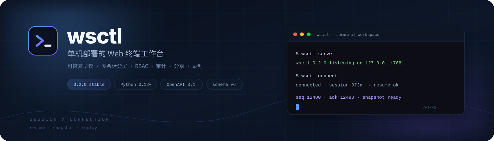
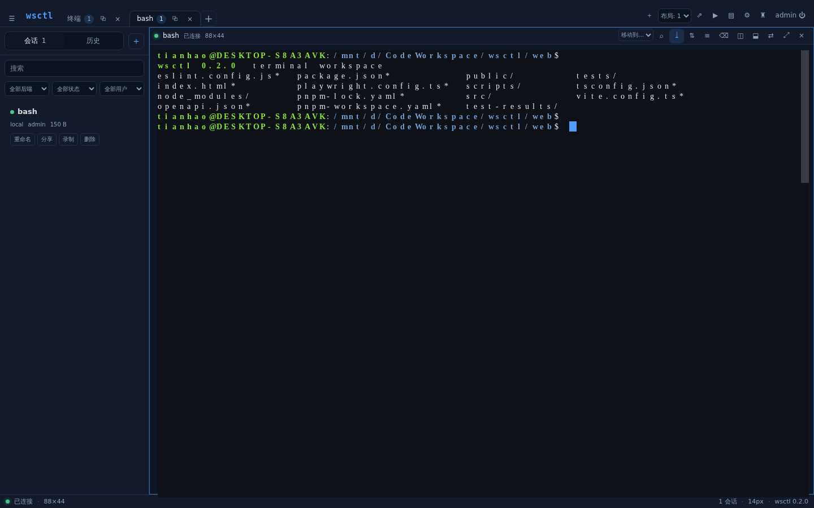
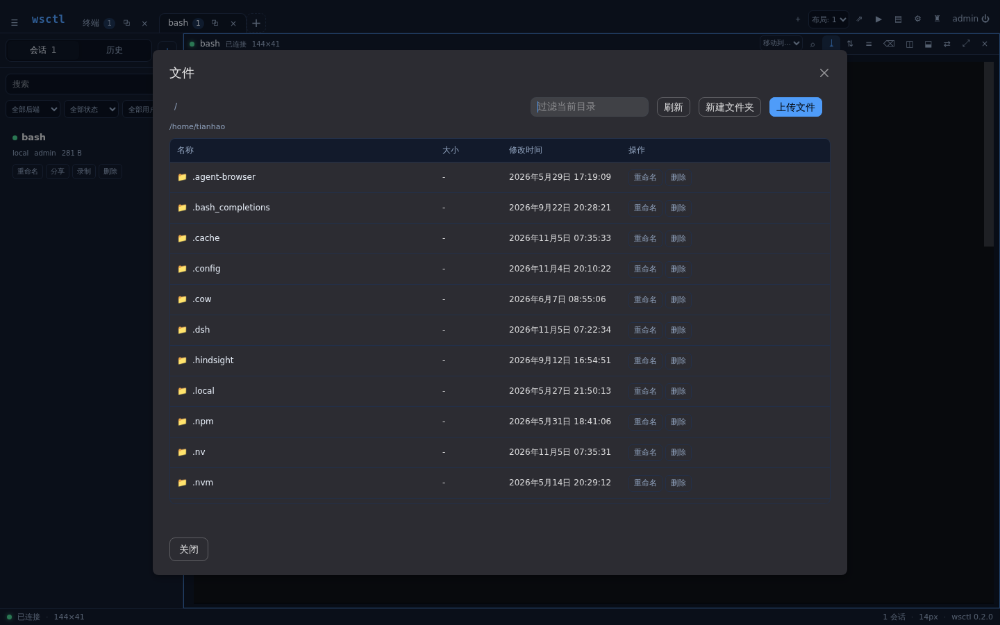
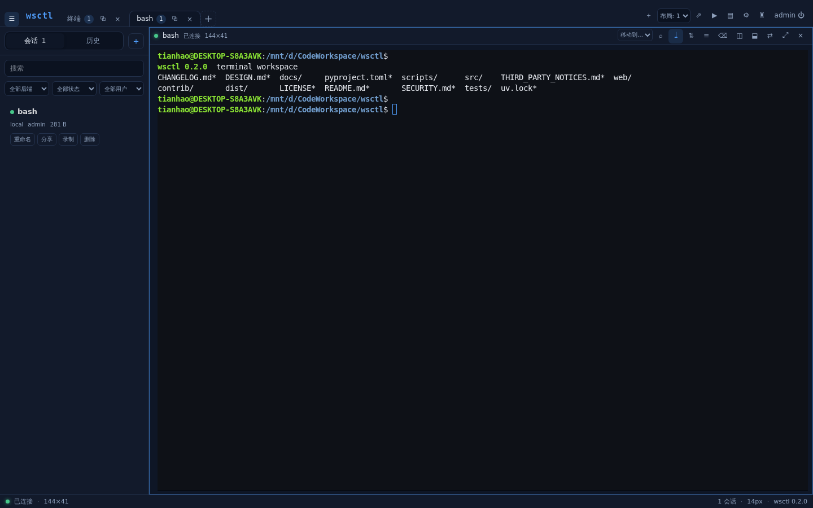
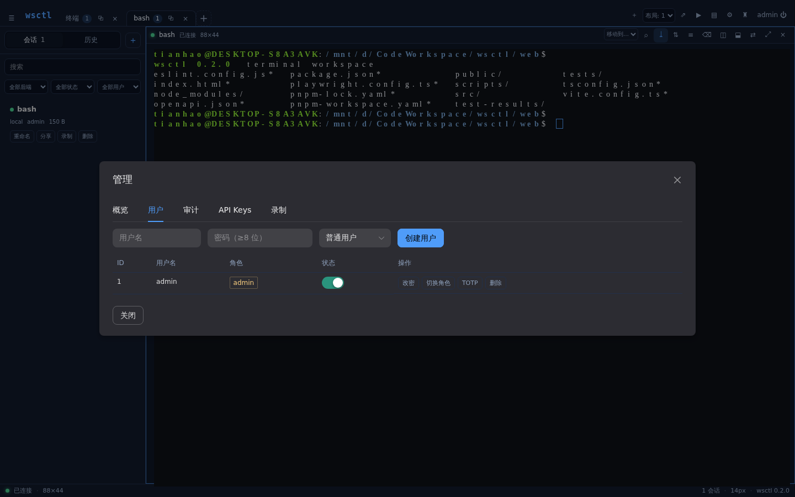
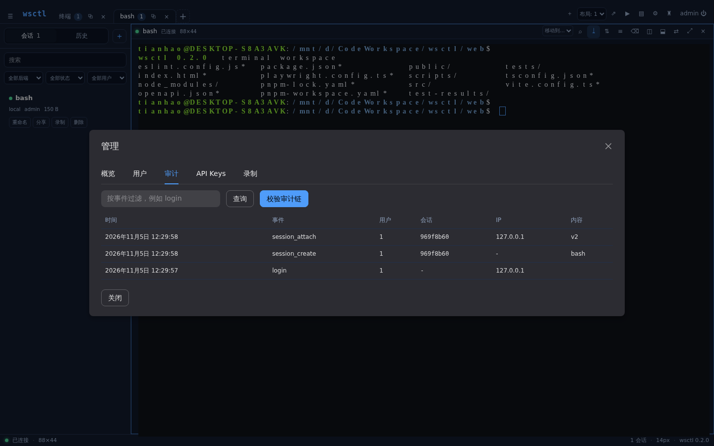
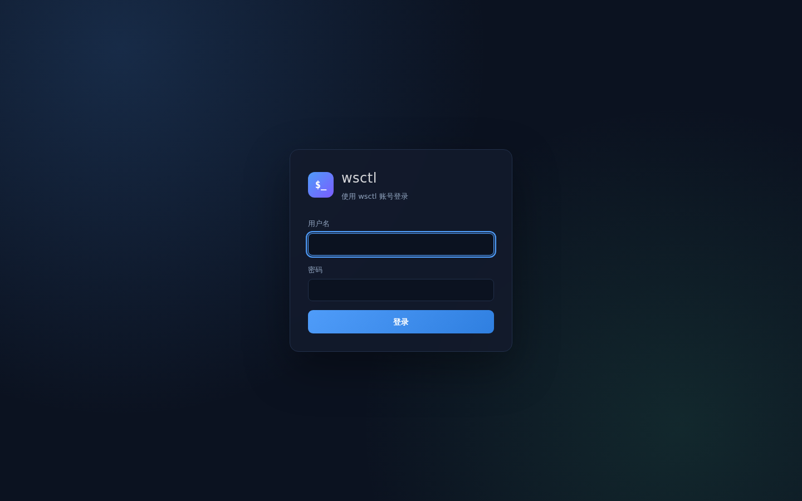
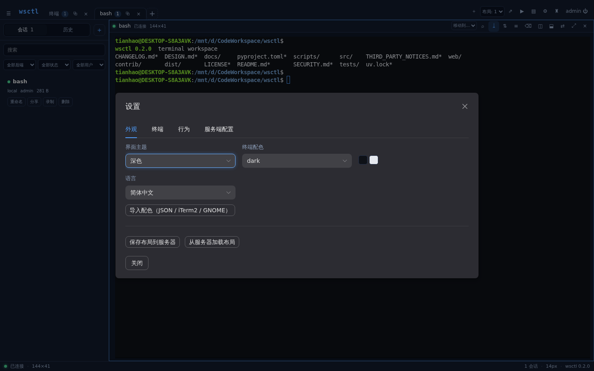
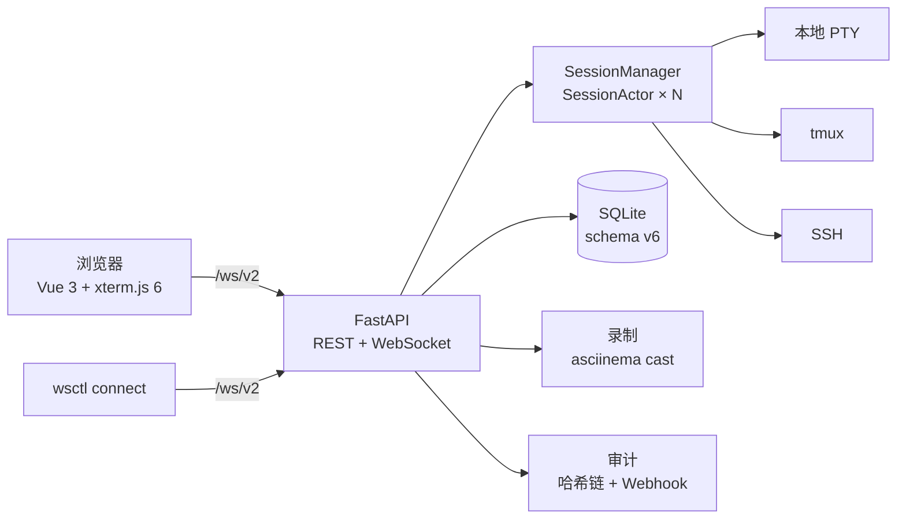

<p align="center">
  
</p>

<p align="center">
  <a href="https://github.com/ThzxxArt/wsctl/actions/workflows/ci.yml"></a>
  <a href="https://pypi.org/project/wsctl/"></a>
  <a href="https://pypi.org/project/wsctl/"></a>
  <a href="https://github.com/ThzxxArt/wsctl/blob/main/LICENSE"></a>
  
  
  
</p>

<p align="center">
  <strong>一条命令，把完整的终端工作台搬进浏览器。</strong><br>
  会话与连接解耦 · 断线精确续传或屏幕快照 · 多用户 RBAC · 审计 · 分享 · 录制
</p>

<p align="center">
  <a href="#快速开始">🚀 快速开始</a> ·
  <a href="#界面">🖼️ 界面</a> ·
  <a href="#配置">⚙️ 配置</a> ·
  <a href="#cli">⌨️ CLI</a> ·
  <a href="#部署">📦 部署</a> ·
  <a href="#完整卸载">🧹 卸载</a> ·
  <a href="#文档">📚 文档</a>
</p>

---

## 为什么是 wsctl

| 🔁 会话与连接解耦 | 🪟 一个真正的终端工作台 | 🛡️ 从单人到团队 |
| :--- | :--- | :--- |
| 关掉笔记本不会杀掉 shell。重连时从断点**精确续传**；滚动缓冲已淘汰时自动取**屏幕快照**，快照不可用则回退到全量回放并让应用自身重绘。 | 标签、分屏、命令面板、命令块、终端搜索、文件编辑、主题、PWA 与移动端工具栏，都在一个页面里。 | 多用户 RBAC、TOTP、API Keys、分享链接、审计哈希链、Webhook 与 Prometheus 指标。 |

`wsctl` 是单机部署的 Web 终端服务：一个进程托管 N 个会话，浏览器和 CLI 都是它的客户端。
它不把“网页终端”做成一个 `<iframe>` 里的 shell，而是把**终端会话**当作一等对象——
连接断了，会话还在；服务重启了，tmux 会话还能被接管；有人分享只读链接，权限边界也在。

### 核心能力

- **协议 v2**：`/ws/v2` 使用带序号的数据帧，协商 `wsctl.terminal.v2`；支持
  `ack` / `resume` / `gap` / `snapshot`。慢客户端优先丢帧而不是立即断链，
  失步后由应用自身重绘修复。
- **多会话 / 多标签 / 分屏**：一个标签里可以并排或上下分屏，拖拽调比例、键盘换焦点、
  刷新后布局恢复；关掉分屏只是拆掉视图，不会结束会话。
- **多用户与权限**：`admin` / `user` 两级 RBAC；管理员可管理全部会话、用户、审计、录制；
  普通用户只能看到自己的会话。
- **分享**：一个会话多条链接，`read` / `write` / `control` 三种 scope，支持标签、
  有效期、随时撤销与在线观众列表；`/s/<token>` 是干净 URL，链接跨服务重启有效。
- **API Keys**：`wsctl_...` bearer token，只存 SHA-256 哈希；scope、过期时间、
  最后使用时间；HTTP 与两个 WebSocket 端点都执行同一套 scope。
- **HTTP API v2**：`/api/v2` 提供 RFC 9457 Problem Details、游标分页、
  `Idempotency-Key`、ETag 与 OpenAPI 3.1；旧 `/api` 保留一版带 `Deprecation`
  头的兼容别名。
- **审计**：登录、会话、文件、分享、用户与配置操作全量记录；每条记录带
  `prev_hash` / `hash`，`/api/v2/audit/verify` 可校验哈希链；支持 Webhook。
- **文件工作区**：浏览、分页、过滤、上传（队列/进度/取消/409 覆盖确认）、下载、
  新建目录、重命名、删除空目录、文本预览与原子编辑、图片按内容预览。
- **录制与回放**：asciinema cast 录制，浏览器内回放；会话、状态、大小进入 SQLite
  索引，可按会话下载，也可在管理员录制库中管理。
- **终端能力**：xterm.js 6、Shell Integration（OSC 133/633）命令块、Sixel 图像、
  可选 ZMODEM（`sz`/`rz`）、搜索、字号与主题导入。
- **工作台状态**：布局可保存到服务端并在设备间加载；命令块、会话历史（结束原因 /
  退出码 / 时间线 / 重新打开）、在线观众与后台动静提醒让“另一个标签里发生了什么”可见。
- **PWA 与通知**：可安装为 PWA，离线时显示恢复提示；Web Push（VAPID，可选）、
  移动端工具栏与窄屏堆叠布局。
- **后端**：本地 PTY、tmux（跨重启恢复）、SSH（跳板）；`ssh -o` 选项有本地命令执行白名单。
- **运维**：`wsctl start/stop/status/logs/restart/reload` 内置后台生命周期；
  systemd、Docker、nginx 反向代理示例随仓库提供；`restart --rolling` 配合
  `--reuse-port` 可做到端口不拒连的滚动切换（tmux 会话存活；本地/SSH 会话仍会结束）。
- **可观测**：`/healthz`、`/readyz`、Prometheus `/metrics`、JSON 日志、请求 ID、
  可选 OpenTelemetry；维护循环与事件循环延迟都进入指标。

> **边界要诚实**：0.2.0 只支持 **SQLite**。PostgreSQL 在 0.3 提供，配置成其他
> `database_url` 会在启动时明确拒绝，不会“半支持”。纯 Python 转发也不以原始吞吐
> 对标 C/libuv 终端；wsctl 的稳定来自会话解耦、有界缓冲与背压，而不是单连接速度。

## 界面

<p align="center">
  
  <br>
  <sub>终端工作台 · 标签 / 分屏 / 命令块 / 会话侧栏 / 实时状态</sub>
</p>

<p align="center">
  
  
  <br>
  <sub>文件面板 · 会话列表 / 历史 / 结束原因 / 重新打开</sub>
</p>

<p align="center">
  
  
  <br>
  <sub>用户与 TOTP · 审计与哈希链校验</sub>
</p>

<p align="center">
  
  
  <br>
  <sub>登录 · 主题 / 快捷键 / 服务器配置</sub>
  <br>
  <sub>以上截图均来自 wsctl 0.2.0 实际界面</sub>
</p>

## 快速开始

### 1. 安装

```bash
pipx install wsctl
```

没有 pipx？用 `uv` 或普通 venv 也可以，见[安装](#安装)。要求 **Python 3.12+**。

### 2. 启动

```bash
WSCTL_ADMIN_PASSWORD='换成你的强密码' wsctl start --reuse-port
```

`--reuse-port` 让之后的 `wsctl restart --rolling` 不再出现端口拒连窗口；tmux
会话可以存活，本地/SSH 会话仍会随旧进程结束。首次运行会在
`~/.local/share/wsctl/` 建库、创建 `admin`；不传密码环境变量时会生成随机密码，
用 `wsctl logs` 查看。

### 3. 打开浏览器

```text
http://127.0.0.1:7681
```

登录后即可新建终端。右上角的 `+`、命令面板（`Ctrl/Cmd+Shift+P`）或快捷键
`Ctrl/Cmd+Shift+T` 都能创建会话。

### 4. 从命令行接入

```bash
wsctl login http://127.0.0.1:7681
wsctl connect
```

`wsctl connect` 会断线自动重连；默认创建新会话，也可以 `-s <session-id>` 连接已有会话。

### 5. 自检

```bash
wsctl doctor
wsctl status
```

`doctor` 会检查 Python、数据目录、数据库、配置文件、shell、tmux/ssh、端口占用、
磁盘空间、日志轮转与系统时间（TOTP 依赖时钟）；`--json` 适合脚本消费。

## 0.2.0 亮点

| 领域 | 0.2.0 |
| :--- | :--- |
| 前端 | 重写为 **Vue 3.5 + TypeScript 5.9 + Vite 8 + Pinia + Naive UI + xterm.js 6**；标签、分屏、命令面板、文件编辑、主题导入、PWA 与移动端工具栏 |
| 协议 | **`/ws/v2` + `wsctl.terminal.v2`**；序号、ACK、精确续传、gap、屏幕快照；旧 `/ws` 保留一版兼容别名，但只发送原始字节 |
| 数据 | **SQLAlchemy 2.1 + Alembic**；schema v6，head `0004_session_exit_code`；迁移前自动一致性备份；0.2.0 唯一支持 SQLite |
| 配置 | 分节 TOML，支持 `"8MiB"` / `"12h"`；`wsctl config migrate` 保留注释并备份；热更新 / 仅新对象 / 需重启三档如实标注 |
| 安全 | Argon2、TOTP、API Key scope、分享 token 哈希、Origin + scheme 校验、CSP/SRI、请求体上限、IP/登录限速、数据库与录制文件 `0600` |
| 观测 | structlog、prometheus-client、OpenTelemetry（可选）、请求 ID、`/readyz`、审计哈希链、Webhook |
| 质量 | pytest **728**、Vitest **40**、Playwright Chromium / Firefox / WebKit / 移动端、视觉回归、后端 e2e 全场景 |

> 从 0.1.x 升级前请先备份并按 [迁移指南](https://github.com/ThzxxArt/wsctl/blob/main/docs/MIGRATION-0.2.0.md)
> 执行 `config migrate` → `migrate --apply` → 启动演练。0.2.0 数据库不能直接回退到 0.1.x。

## 架构



**一个会话一个串行化 Actor。** 输出、attach、detach、stop 都进入同一个 mailbox，
状态变更不再依赖“谁先抢到锁”。广播在会话锁内把数据追加到带字节序号的
`Scrollback`，再按客户端各自的预算出队；慢查看者被丢帧而不是被断链，失步会收到
精确的 `gap` 范围。

## 安装

| 方式 | 适合 | 命令 |
| :--- | :--- | :--- |
| **pipx** | 大多数用户，隔离且自动进 PATH | `pipx install wsctl` |
| **uv** | 想顺便管理 Python 版本 | `uv tool install wsctl` |
| **venv + pip** | 完全自控的部署 | 见下 |
| **Docker** | 容器化 / 试跑 | 见[部署](#部署) |
| **源码** | 开发与贡献 | `pip install -e ".[dev]"` |

```bash
# venv + pip
python3.12 -m venv /opt/wsctl/venv
/opt/wsctl/venv/bin/pip install -U pip wsctl

# 源码
git clone https://github.com/ThzxxArt/wsctl.git
cd wsctl
python3.12 -m venv .venv && . .venv/bin/activate
pip install -e ".[dev]"
```

可选依赖：`wsctl[win]` 提供 Windows PTY；`tmux`、`ssh`、`lrzsz` 是系统命令，
按需安装。发布 wheel 已内置前端构建产物，**用户侧不需要 Node/pnpm**。

## 配置

配置文件默认在 `~/.config/wsctl/config.toml`。0.2.0 使用分节 TOML：

```toml
[server]
host = "127.0.0.1"
port = 7681
reuse_port = false

[auth]
auth_required = true
session_ttl = "12h"
cookie_secure = true          # 走 HTTPS 时开启

[security]
trust_proxy = false           # 在反向代理后设为 true
trusted_proxies = []          # 非回环代理的 CIDR
allowed_ips = []              # 空 = 不限制来源

[terminal]
default_shell = "/bin/bash"
scrollback_bytes = "8MiB"
snapshot_mode = "auto"        # auto | always | off
shell_integration = true

[files]
file_root = "/home/wsctl"
file_max_upload = "100MiB"

[observability]
metrics_enabled = true
log_json = false
```

优先级：**命令行参数 > `WSCTL_*` 环境变量 > 配置文件**。配置项支持
`wsctl config set server.port 9000` / `wsctl config set auth.required false`
这样的分节写法；值会先经过类型校验，整文件校验通过后才原子落盘，并保留行内注释。

```bash
wsctl config show                 # 查看生效配置（--json）
wsctl config get port             # 查看单项
wsctl config set server.port 9000
wsctl config validate
wsctl reload                      # 或 wsctl config reload
```

Web 管理面的“配置”页签按**立即生效 / 仅新会话 / 需重启**三档标注，需重启项不会
假装已保存。0.1.x 的扁平 TOML 可执行 `wsctl config migrate` 自动转换；详见
[迁移指南](https://github.com/ThzxxArt/wsctl/blob/main/docs/MIGRATION-0.2.0.md)。

## CLI

> 每个命令的完整选项、环境变量、组合工作流与故障恢复见
> **[CLI 完整教程](docs/CLI.md)**。下面是速查表。

| 命令 | 用途 |
| :--- | :--- |
| `wsctl serve` | 前台启动；`--daemon` 转后台 |
| `wsctl start / stop / status / logs / restart / reload` | 内置后台生命周期，无需 systemd |
| `wsctl restart --rolling` | 端口不拒连的滚动重启（首次启动需 `--reuse-port`；tmux 会话可活，本地/SSH 会话会结束） |
| `wsctl doctor` | 环境、配置、依赖与实例自检 |
| `wsctl connect [URL] [-s ID]` | 把当前终端接入远程会话，断线自动重连 |
| `wsctl session list / new / rename / attach / kill` | 会话管理 |
| `wsctl session record / record-stop / recording` | 录制、停止与下载 |
| `wsctl user add / list / passwd / role / disable / enable / totp` | 用户与 TOTP |
| `wsctl audit` | 查看审计日志（管理员） |
| `wsctl config show / get / set / validate / reload` | 配置管理 |
| `wsctl migrate --check / --apply` | 数据库迁移检查与执行 |
| `wsctl backup / restore` | 一致性备份与恢复 |
| `wsctl shell-integration install` | 安装 OSC 133/633 命令块脚本 |
| `wsctl push keys` | 生成 Web Push VAPID 密钥 |

**升级后推荐**：

```bash
wsctl restart --rolling
```

不要在 wsctl 自己的网页终端里执行不带 `--rolling` 的 `stop` / `restart`：那会结束
当前会话，也结束正在执行命令的 shell。CLI 会拒绝这种自断后路的操作。

## 部署

### systemd

仓库提供 [`contrib/systemd/wsctl.service`](https://github.com/ThzxxArt/wsctl/blob/main/contrib/systemd/wsctl.service)。
把 `ExecStart` 指向实际安装路径，默认只监听本机，由反向代理终止 TLS：

```ini
[Service]
User=wsctl
Group=wsctl
WorkingDirectory=/var/lib/wsctl
ExecStart=/opt/wsctl/venv/bin/wsctl serve --host 127.0.0.1 --port 7681
Restart=on-failure
KillSignal=SIGINT
TimeoutStopSec=15
NoNewPrivileges=true
PrivateTmp=true
ProtectSystem=full
```

```bash
sudo systemctl daemon-reload
sudo systemctl enable --now wsctl
```

### nginx 反向代理

完整配置见 [`contrib/nginx/wsctl.conf`](https://github.com/ThzxxArt/wsctl/blob/main/contrib/nginx/wsctl.conf)，
关键是保留 WebSocket 升级头与 `Host`：

```nginx
location / {
    proxy_pass http://127.0.0.1:7681;
    proxy_http_version 1.1;
    proxy_set_header Upgrade $http_upgrade;
    proxy_set_header Connection "upgrade";
    proxy_set_header Host $http_host;   # 保留外部端口，Origin 校验需要
    proxy_set_header X-Forwarded-For $proxy_add_x_forwarded_for;
    proxy_set_header X-Forwarded-Proto $scheme;
    proxy_read_timeout 3600s;
    proxy_buffering off;
}
```

代理在另一台机器上时，把它的地址写进 `trusted_proxies`，并设置
`trust_proxy = true`、`cookie_secure = true`。否则限速、IP 白名单和审计只能看到
代理自己的地址。

### Docker

```bash
WSCTL_ADMIN_PASSWORD='换成你的强密码' \
  docker compose -f contrib/docker/docker-compose.yml up -d
```

镜像包含 `tmux`、`openssh-client`、`lrzsz`；`/data` 存数据库/录制/配置，
`/workspace` 是文件面板根目录，两个卷分开。首次运行前请让 UID 10001 可写：

```bash
mkdir -p data workspace
sudo chown -R 10001:10001 data workspace
```

也可以直接 `docker build -t wsctl -f contrib/docker/Dockerfile .`，构建上下文必须是仓库根目录。

### HTTPS

```bash
wsctl serve --tls-self-signed
```

浏览器只在安全上下文（HTTPS 或 localhost）提供剪贴板与系统通知。自签证书适合内网；
公网请用正式证书或反向代理终止 TLS。

## 完整卸载

> **先备份，再删除。** `wsctl backup` 生成的 tar.gz 是恢复历史、录制和分享配置的
> 唯一完整副本；`rm -rf` 之后无法找回。

```bash
# 删除前先确认路径（不要凭记忆猜）
wsctl config get config_path
wsctl config get data_dir
```

默认路径通常是：

| 内容 | 默认位置 |
| :--- | :--- |
| 配置、凭据、Shell Integration | `~/.config/wsctl/` |
| 数据库、录制、run 日志、自签证书 | `~/.local/share/wsctl/` |
| systemd 数据目录（示例） | `/var/lib/wsctl/` |
| systemd 日志（若配置） | `/var/log/wsctl/` |
| Docker 数据 / 工作区 | `/data`、`/workspace` |

如果设置了 `XDG_CONFIG_HOME`、`XDG_DATA_HOME`、`WSCTL_CONFIG` 或
`WSCTL_DATA_DIR`，以 `wsctl config get` 的输出为准。

### 1. 停止服务

**内置后台实例**：

```bash
wsctl stop
# 如果提示“不能自断后路”，并且你确认要停止：
wsctl stop --i-know-this-drops-my-connection
```

**systemd**：

```bash
sudo systemctl disable --now wsctl
sudo rm -f /etc/systemd/system/wsctl.service
sudo systemctl daemon-reload

# 如果装的是用户级 unit：
systemctl --user disable --now wsctl 2>/dev/null || true
rm -f ~/.config/systemd/user/wsctl.service
systemctl --user daemon-reload 2>/dev/null || true
```

**Docker Compose**：

```bash
cd contrib/docker
# compose 文件要求该变量存在，down 也需提供（值不会用于已有容器）
WSCTL_ADMIN_PASSWORD=unused docker compose down
# 同时删除 compose 创建的命名卷（如果有）：
WSCTL_ADMIN_PASSWORD=unused docker compose down -v
docker rm -f wsctl 2>/dev/null || true
docker rmi wsctl:latest 2>/dev/null || true
```

如果使用 bind mount（本仓库示例的 `./data`、`./workspace`），`down -v` 不会
删除宿主机目录，需要手动删除（见第 3、4 步）。

### 2. 卸载程序

按你当初的安装方式选一条：

```bash
# pipx
pipx uninstall wsctl

# uv tool
uv tool uninstall wsctl

# 普通 venv / 系统 pip
python3 -m pip uninstall wsctl
# 或直接删除专用 venv：
rm -rf /opt/wsctl/venv

# 源码安装
cd /path/to/wsctl
python3 -m pip uninstall wsctl
cd ..
rm -rf /path/to/wsctl
```

确认命令已经消失：

```bash
command -v wsctl || echo "wsctl 已从 PATH 移除"
```

### 3. 删除配置与凭据

```bash
rm -rf ~/.config/wsctl
```

这会删除：

- `config.toml`
- `credentials.json`（`wsctl login` 缓存的 token）
- `shell-integration/`
- `config.toml.v1.bak` 等迁移备份

如果你设置了自定义路径，先确认再删；不要直接删除配置文件的整个父目录，那里
可能有其他程序的文件：

```bash
CONFIG_PATH=$(wsctl config get config_path)
rm -f "$CONFIG_PATH"
rm -f "$(dirname "$CONFIG_PATH")/credentials.json"
rm -rf "$(dirname "$CONFIG_PATH")/shell-integration"
```

### 4. 删除数据

```bash
rm -rf ~/.local/share/wsctl
```

这会删除 SQLite 数据库、WAL/SHM、录制、`run/` 日志与 PID、自签 TLS 证书，
以及恢复时产生的 `.bak` 文件。**删除前务必确认已经备份。**

自定义数据目录：

```bash
wsctl config get data_dir
# 例如输出 /srv/wsctl-data，则：
sudo rm -rf /srv/wsctl-data
```

systemd 部署通常还要清理：

```bash
sudo rm -rf /var/lib/wsctl /var/log/wsctl
```

Docker 部署清理宿主机挂载目录：

```bash
rm -rf ./data ./workspace
```

### 5. 清理 Shell 集成与补全

如果安装过 `wsctl shell-integration install --write-rc`，从对应 rc 文件删除
`# wsctl shell integration` 及其后的 `source` 行：

```bash
grep -n "wsctl shell integration" ~/.bashrc ~/.zshrc \
  ~/.config/fish/config.fish 2>/dev/null
```

然后删除集成脚本：

```bash
rm -rf ~/.config/wsctl/shell-integration
```

补全脚本由 `wsctl completion install` 写入；删除 rc 中与 `_WSCTL_COMPLETE`
相关的行，并删除该命令输出中提示的补全文件即可：

```bash
grep -n "_WSCTL_COMPLETE" ~/.bashrc ~/.zshrc 2>/dev/null
```

### 6. 确认已清理

```bash
command -v wsctl
ls ~/.config/wsctl ~/.local/share/wsctl 2>/dev/null
systemctl status wsctl 2>/dev/null
docker ps -a | grep wsctl || true
```

### 7. 保留数据迁移到新机器

如果只是想换机器而不是彻底删除：

```bash
# 旧机器
wsctl backup /tmp/wsctl-move.tar.gz --include-config

# 新机器：安装后恢复
wsctl restore /tmp/wsctl-move.tar.gz --with-config
wsctl doctor
wsctl start --reuse-port
```

完整的命令组合、选项解释与故障恢复见
[CLI 完整教程](docs/CLI.md)。

## 安全

Web 终端本质上是**远程代码执行服务**，请像对待 SSH 一样对待它：

- 默认开启认证；密码用 Argon2 哈希，登录 token 与会话 token 只存哈希。
- 支持 TOTP 双因子、登录失败限速、`allowed_ips` CIDR 白名单。
- WebSocket 与 HTTP 写请求都校验 `Origin`（含 scheme）；认证 API 响应默认
  `Cache-Control: no-store`（配置端点带 ETag，显式使用 `private, no-store` 与
  `Vary`）；CSP 禁止内联脚本，静态入口资源带 SRI。
- API Key 只存哈希；分享链接支持 scope / 有效期 / 撤销；只读链接拒绝输入。
- 文件面板对路径做解析后校验，拒绝越界与符号链接写入；上传默认不覆盖，覆盖需显式确认。
- SQLite、WAL/SHM、配置、录制与备份文件统一 `0600`；迁移前自动备份。
- 每会话可配置连接数、内存与输入速率上限；慢客户端丢帧而不是拖垮服务端。
- 审计哈希链可校验；保留策略清理旧记录时会把链头标记为 `truncated`，不误报篡改。

**不要**把 `--no-auth` 暴露到网络。RBAC 控制的是会话可见性与管理权限，不是命令级
沙箱；能登录并创建会话的账号，本质上拥有以服务运行用户身份执行命令的能力。

更多约定见 [SECURITY.md](https://github.com/ThzxxArt/wsctl/blob/main/SECURITY.md)。

## 性能

开发机上的可重复 smoke 基线（真实 PTY + `/ws/v2`，Python 3.13）：

| 指标 | 0.2.0 |
| :--- | ---: |
| `seq 1 200000` 单会话 | **236 ms** |
| 8 个会话各 20 万行 | **1758 ms** |
| attach 到 `attached` | **91 ms** |
| 断线续传（`last_seq` 命中） | **1.8 ms** |
| 100 空闲会话 RSS 增量 | **0.3 MiB** |
| 首屏 JS（gzip，不含懒加载） | **393.2 KiB** |

这些是 smoke baseline，不是跨机器硬门槛；复现命令与说明见
[`docs/benchmarks/0.2.0.md`](https://github.com/ThzxxArt/wsctl/blob/main/docs/benchmarks/0.2.0.md)。

## 开发

```bash
python3.12 -m venv .venv
. .venv/bin/activate
pip install -e ".[dev]"
ruff check . && mypy src && pytest
```

前端与浏览器测试：

```bash
cd web
pnpm install
pnpm typecheck && pnpm test
pnpm exec playwright install --with-deps chromium firefox webkit
WSCTL_PYTHON=../.venv/bin/python pnpm e2e
```

后端端到端场景（server / CLI / connect / tmux / crash / multiplex / daemon / 重启）：

```bash
python scripts/e2e/run_all.py
```

前端目录、设计令牌与测试策略见
[docs/FRONTEND.md](https://github.com/ThzxxArt/wsctl/blob/main/docs/FRONTEND.md)。

## 文档

| 文档 | 内容 |
| :--- | :--- |
| [CLI 完整教程](https://github.com/ThzxxArt/wsctl/blob/main/docs/CLI.md) | 全部命令、选项、组合工作流、环境变量与故障恢复 |
| [ROADMAP-0.2.0](https://github.com/ThzxxArt/wsctl/blob/main/docs/ROADMAP-0.2.0.md) | 0.2.0 范围、实施结果、审查修复与明确边界 |
| [MIGRATION-0.2.0](https://github.com/ThzxxArt/wsctl/blob/main/docs/MIGRATION-0.2.0.md) | 0.1.x → 0.2.0 备份、配置、数据库与回退 |
| [DESIGN](https://github.com/ThzxxArt/wsctl/blob/main/DESIGN.md) | 产品边界、架构与关键取舍 |
| [SECURITY](https://github.com/ThzxxArt/wsctl/blob/main/SECURITY.md) | 威胁模型、凭据、分享、文件与部署约定 |
| [ADR-0003](https://github.com/ThzxxArt/wsctl/blob/main/docs/ADR/0003-database.md) | 为什么 0.2.0 只支持 SQLite，PostgreSQL 推迟到 0.3 |
| [FRONTEND](https://github.com/ThzxxArt/wsctl/blob/main/docs/FRONTEND.md) | Vue 工作台目录、构建、测试与发布约束 |
| [CHANGELOG](https://github.com/ThzxxArt/wsctl/blob/main/CHANGELOG.md) | 版本变更与修复记录 |
| [benchmarks](https://github.com/ThzxxArt/wsctl/blob/main/docs/benchmarks/0.2.0.md) | 性能基线、复现命令与测量环境 |

## 许可

[MIT](https://github.com/ThzxxArt/wsctl/blob/main/LICENSE) © 2026 ThzxxArt

预构建前端与 Python 依赖的第三方许可证说明见
[THIRD_PARTY_NOTICES.md](https://github.com/ThzxxArt/wsctl/blob/main/THIRD_PARTY_NOTICES.md)。
